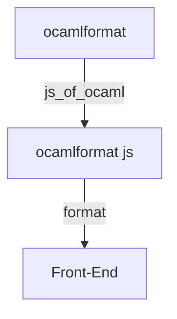
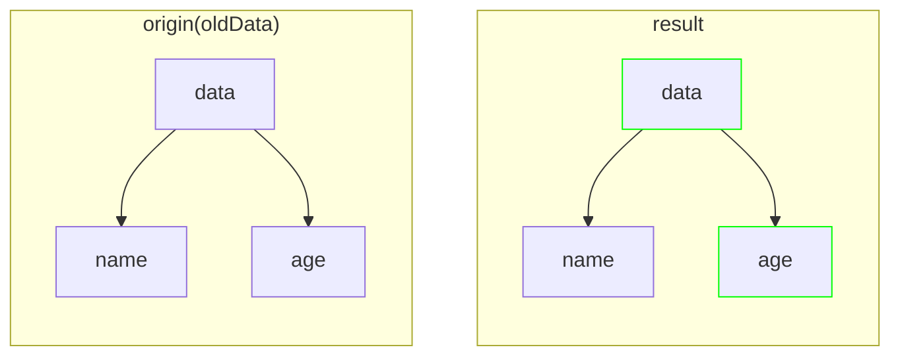
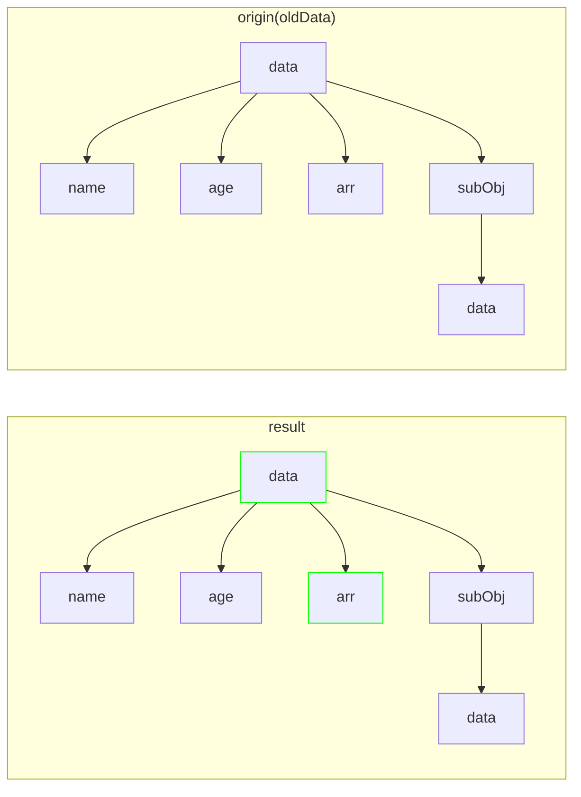
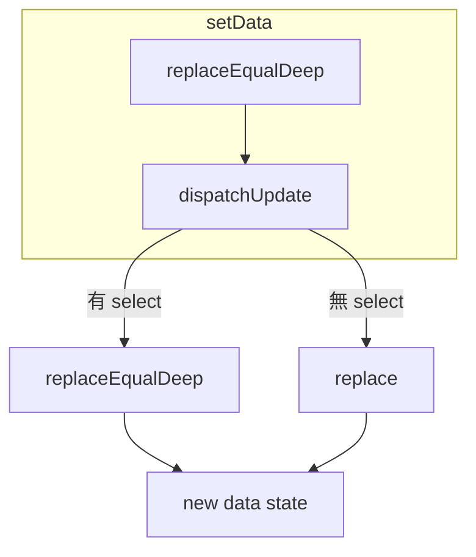
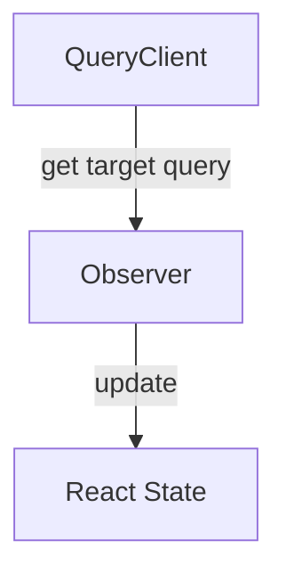
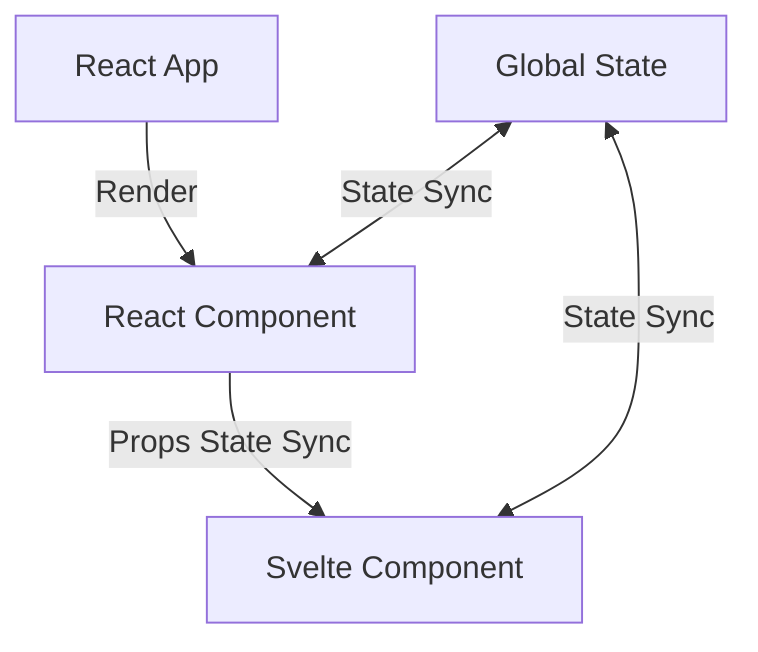

# Markdown 範本與渲染測試

這頁依現有部落格的 Markdown 盤點產生，可作為往後調整版型與渲染器時的比較基準。程式碼、公式與圖表節錄自文章正文；前置資料與站內連結已依遷移規則統一。

- [文字與標題](#文字與標題)
- [清單與引用](#清單與引用)
- [連結與圖片](#連結與圖片)
- [程式碼語言](#程式碼語言)
- [數學公式](#數學公式)
- [Mermaid 圖表](#mermaid-圖表)
- [額外補充：表格](#額外補充：表格)

## 文字與標題

一般段落包含繁體中文、English、**粗體**、*斜體*、***粗斜體***、~~刪除線~~ 與 `inline code`。

### 第三級標題

#### 第四級標題

##### 第五級標題

###### 第六級標題

這是第一行，接續原始 Markdown 的一般換行。
這一行應延續同一段落。

這一行結尾有兩個空白，應強制換行。  
這一行應顯示在下一行。

跳脫字元：\*不是斜體\*、\<Component\>、\$100。

模板字元應原樣顯示：`{{ title }}`、``、`$countStore`。

---

## 清單與引用

- 第一層項目
  - 第二層項目
    - 第三層項目
- 含 **粗體** 和 `code` 的項目

1. 第一個步驟
2. 第二個步驟
   1. 巢狀步驟
   2. 另一個巢狀步驟

> 引用段落，包含 **粗體**、*斜體* 與 [連結](https://www.11ty.dev/)。
>
> - 引用內的清單
> - 另一個項目
>
> > 巢狀引用

## 連結與圖片

[外部連結](https://www.11ty.dev/)、[站內首頁](/)、[相對路徑](./relative-target/)、[頁內錨點](#數學公式)。

自動連結：<https://www.11ty.dev/>。

以下為本機圖片，可檢查寬度與替代文字，無須外部網路。


## 程式碼語言

每種實際使用的 fence 語言都保留一份原文節錄。無語言、plain、plaintext 與 txt 應以純文字顯示；HTML、JSX 與 Svelte 的標記應保持在程式碼區塊內，不可執行。

### 無語言標籤

來源：`posts/2024/function-compose.md:161`

```
A => ((A, B) => C)(A, B)
```

### bash

來源：`tech/troubleshooting/appimage.md:31`

```bash
ls /usr/lib/binfmt.d/appimage.conf
```

### diff

來源：`posts/2025/mixing-react-and-svelte-components.md:142`

```diff
import { memo, useLayoutEffect, useRef } from "react";
import { type Component, mount } from "svelte";

export const createSvelteComponent = <Props extends Record<string, any>>(
  component: Component<Props>,
) => {
  function SvComponent(props: Props) {
    const ref = useRef<HTMLDivElement>(null);

    useLayoutEffect(() => {
      while (ref.current?.firstChild) {
        ref.current.firstChild.remove();
      }

      if (ref.current) {
        mount(component, { target: ref.current, props });
      }
-   }, []);
+   }, Object.values(props));

    return <div ref={ref}></div>;
  }

  SvComponent.displayName = component.name;

  return memo(SvComponent);
};
```

### html

來源：`notes/n-2.md:11`

```html
<script>
	let count = 0;

	function increment() {
		count++
	}
</script>
```

### javascript

來源：`posts/2024/function-compose.md:15`

```javascript
const filterEmpty = (arr) => {
    return filter(arr, (value) => !!value)
}
```

### js

來源：`notes/n-3.md:11`

```js
function handleAnchor(params){
    // ...
}

function useAnchor(params, option){
    const { enabled = true } = option

    const isScrolled = useRef(false)

    useEffect(()=>{
        if(!isScrolled.current && enabled){
            setTimeout(() => {
                handleAnchor(params)
            }, 0)
        }
    }, [enabled])
}
```

### json

來源：`tech/tool.md:34`

```json
{
  "workbench.colorCustomizations": {
    "activityBar.background": "#2a384e",
    "activityBar.activeBackground": "#026881",
    "activityBar.activeBorder": "#ffffff",
    "activityBar.foreground": "#ffffff",
    "statusBar.background": "#20686d",
    "tab.inactiveBackground": "#222222",
    "statusBar.foreground": "#ffffff",
    "activityBarBadge.background": "#00864e",
    "statusBar.border": "#00000000",
    "tab.activeBackground": "#284049",
    "tab.activeBorderTop": "#a6ff00"
  },
  "editor.tokenColorCustomizations": {
    "textMateRules": [
      {
        "name": "One Dark italic",
        "scope": [
          "comment",
          "entity.other.attribute-name",
          "keyword",
          "markup.underline.link",
          "storage.modifier",
          "storage.type",
          "string.url",
          "variable.language.super",
          "variable.language.this"
        ],
        "settings": {
          "fontStyle": "italic"
        }
      }
    ]
  }
}
```

### jsx

來源：`posts/2024/component-design-guide.md:110`

```jsx
const Component = () => {
  // ...

  if (isLayoutA) {
    return (
      <div>
        <div></div>

        <div>
          <ul>
            <li></li>
            <li></li>
            <li></li>
          </ul>
        </div>
      </div>
    );
  }

  return (
    <div>
      <div>
        <p></p>
      </div>

      <div>
        <ol>
          <li></li>
          <li></li>
          <li></li>
        </ol>
      </div>
    </div>
  );
};
```

### lisp

來源：`notes/n-9.md:14`

```lisp
(env (dev (flags :standard -warn-error -27-32)))
```

### lua

來源：`tech/tool.md:75`

```lua
local wezterm = require 'wezterm';

return {
    color_scheme = "ayu",

    font = wezterm.font('Monaspace Neon', { weight = 'DemiLight' }),
    font_size = 18,

    window_background_opacity = 0.95,

    initial_cols = 100,
    initial_rows = 30,

    clean_exit_codes = { 130 },

    colors = {
      tab_bar = {
        background = '#ffffff',

        inactive_tab = {
          bg_color = "#214358",
          fg_color = "#AEB8C4",
        },

        active_tab = {
          bg_color = "#151B25",
          fg_color = "#9CA6B8",
        },
      }
    },
  }
```

### ocaml

來源：`notes/n-8.md:13`

```ocaml
let f s =
  print_endline s;
  s
;;

let lazy_value = lazy (f "lazy")
```

### plain

來源：`posts/2024/component-design-guide.md:18`

```plain
        / \
       /App\
      /-----\
     /  page \
    /---------\
   / page comp \
  /-------------\
 /   component   \
/-----------------\
```

### plaintext

來源：`tech/tool.md:139`

```plaintext
[alias]
    sw = switch
    co = checkout
    st = status
```

### rust

來源：`posts/2022/rust-async-programming.md:79`

```rust
struct Task {
  future: Mutex<Option<BoxFuture<'static, ()>>>,
  task_sender: SyncSender<Arc<Task>>,
}

impl ArcWake for Task {
  fn wake_by_ref(arc_self: &Arc<Self>) {
    let cloned = arc_self.clone();
    arc_self
      .task_sender
      .send(cloned)
      .expect("too many task queued");
  }
}
```

### svelte

來源：`posts/2025/mixing-react-and-svelte-components.md:128`

```svelte
<script lang="ts">
  import { countStore } from "./store"; 
</script>

<p>{$countStore}</p>
```

### toml

來源：`tech/tool.md:113`

```toml
add_newline = false
right_format = """$time"""

[character]
success_symbol = '[λ](bold green)'
error_symbol = '[λ](bold red)'
vimcmd_symbol = '[<](bold green)'
vimcmd_replace_one_symbol = '[<](bold purple)'
vimcmd_replace_symbol = '[<](bold purple)'
vimcmd_visual_symbol = '[<](bold yellow)'

[line_break]
disabled = false

[git_branch]
format = 'on [$branch(:$remote_branch)]($style) '

[time]
disabled = true
time_format = '%F %T'
format = '[$time]($style)'
```

### ts

來源：`posts/2023/think-of-types-like-sets.md:69`

```ts
type Boolean = true | false;
```

### tsx

來源：`posts/2025/mixing-react-and-svelte-components.md:80`

```tsx
import Demo from "./Demo.svelte";

const ReactDemo = createSvelteComponent(Demo);

export default ReactDemo;
```

### txt

來源：`tech/troubleshooting/appimage.md:53`

```txt
~/AppImages/
```

### typescript

來源：`posts/2022/functor-and-JSTS.md:180`

```typescript
of = T -> Option<T>
```

## 數學公式

包含原文所有不重複的行內與區塊公式。KaTeX 會保留解析錯誤；若公式本身有問題，應修正原文或訂出明確遷移規則。

### 公式 1

來源：`posts/2022/functor-and-JSTS.md`

行內公式：$C$。

### 公式 2

來源：`posts/2022/functor-and-JSTS.md`

行內公式：$D$。

### 公式 3

來源：`posts/2022/functor-and-JSTS.md`

行內公式：$F$。

### 公式 4

來源：`posts/2022/functor-and-JSTS.md`

行內公式：$X$。

### 公式 5

來源：`posts/2022/functor-and-JSTS.md`

行內公式：$F(X)$。

### 公式 6

來源：`posts/2022/functor-and-JSTS.md`

行內公式：$f: X \to Y$。

### 公式 7

來源：`posts/2022/functor-and-JSTS.md`

行內公式：$F(f): F(X) \to F(Y)$。

### 公式 8

來源：`posts/2022/functor-and-JSTS.md`

行內公式：$F(id_x)=id_{F(x)}$。

### 公式 9

來源：`posts/2022/functor-and-JSTS.md`

行內公式：$f:X \to Y$。

### 公式 10

來源：`posts/2022/functor-and-JSTS.md`

行內公式：$g:Y \to Z$。

### 公式 11

來源：`posts/2022/functor-and-JSTS.md`

行內公式：$F(g\circ f)=F(g)\circ F(f)$。

### 公式 12

來源：`posts/2022/functor-and-JSTS.md`

行內公式：$f:X\to Y$。

### 公式 13

來源：`posts/2022/functor-and-JSTS.md`

行內公式：$X\to F(X)$。

### 公式 14

來源：`posts/2022/functor-and-JSTS.md`

行內公式：$F(f:X\to Y)$。

### 公式 15

來源：`posts/2023/guild-of-effect-ts.md`

$$M\ a \to (a \to M\ b) \to M\ b$$

### 公式 16

來源：`posts/2023/magma-algebraic-structure.md`

行內公式：$(M,\bullet)$。

### 公式 17

來源：`posts/2023/magma-algebraic-structure.md`

行內公式：$M$。

### 公式 18

來源：`posts/2023/magma-algebraic-structure.md`

行內公式：$a$。

### 公式 19

來源：`posts/2023/magma-algebraic-structure.md`

行內公式：$b$。

### 公式 20

來源：`posts/2023/magma-algebraic-structure.md`

$$a,b\in M \Longrightarrow a \bullet b \in M$$

### 公式 21

來源：`posts/2023/magma-algebraic-structure.md`

行內公式：$\bullet$。

### 公式 22

來源：`posts/2023/magma-algebraic-structure.md`

行內公式：$a,b\in M \Longrightarrow a \bullet b \in M$。

### 公式 23

來源：`posts/2023/monoid-algebraic-structure.md`

行內公式：$S$。

### 公式 24

來源：`posts/2023/monoid-algebraic-structure.md`

$$\\exists e\\in S, \\forall a\\in S\\ \\ a \\bullet e = a\\ \\rm{and} \\ e\\bullet a=a$$

### 公式 25

來源：`posts/2023/monoid-algebraic-structure.md`

行內公式：$e$。

### 公式 26

來源：`posts/2023/monoid-algebraic-structure.md`

行內公式：$a \bullet e = a$。

### 公式 27

來源：`posts/2023/monoid-algebraic-structure.md`

行內公式：$e\bullet a=a$。

### 公式 28

來源：`posts/2023/monoid-algebraic-structure.md`

行內公式：$0$。

### 公式 29

來源：`posts/2023/monoid-algebraic-structure.md`

行內公式：$1$。

### 公式 30

來源：`posts/2023/monoid-algebraic-structure.md`

$$0 + 47 = 47\\ and\\ 47 + 0 =47$$

### 公式 31

來源：`posts/2023/monoid-algebraic-structure.md`

$$1 * 34 = 34\\ and\\ 34 * 1 =47$$

### 公式 32

來源：`posts/2023/monoid-algebraic-structure.md`

$$a,b\\in M \\Longrightarrow a \\bullet b \\in M$$

### 公式 33

來源：`posts/2023/monoid-algebraic-structure.md`

行內公式：$(S,\bullet)$。

### 公式 34

來源：`posts/2023/monoid-algebraic-structure.md`

$$x,y,z\\in S\\Longrightarrow(x\\bullet y)\\bullet z = x\\bullet (y\\bullet z)$$

### 公式 35

來源：`posts/2023/monoid-algebraic-structure.md`

$$\\exists e\\in M, \\forall a\\in M\\ \\ a \\bullet e = a\\ \\rm{and} \\ e\\bullet a=a$$

### 公式 36

來源：`posts/2023/semigroup-algebraic-structure.md`

行內公式：$(M,\ \bullet)$。

### 公式 37

來源：`posts/2023/semigroup-algebraic-structure.md`

行內公式：$x,\ y,\ z$。

### 公式 38

來源：`posts/2023/semigroup-algebraic-structure.md`

行內公式：$((x\bullet y)\bullet z)$。

### 公式 39

來源：`posts/2023/semigroup-algebraic-structure.md`

行內公式：$(x\bullet (y\bullet z))$。

### 公式 40

來源：`posts/2023/semigroup-algebraic-structure.md`

行內公式：$x\bullet y\bullet z$。

### 公式 41

來源：`posts/2023/semigroup-algebraic-structure.md`

$$((x\bullet y)\bullet z) = (x\bullet (y\bullet z))$$

### 公式 42

來源：`posts/2023/semigroup-algebraic-structure.md`

$$((1+2)+3) = (1+(2+3)) = 6$$

### 公式 43

來源：`posts/2023/semigroup-algebraic-structure.md`

$$((1*2)*3) = (1*(2*3)) = 6$$

### 公式 44

來源：`posts/2023/think-of-types-like-sets.md`

行內公式：$\{\}$。

### 公式 45

來源：`posts/2023/think-of-types-like-sets.md`

行內公式：$\{1,2,3\}$。

### 公式 46

來源：`posts/2023/think-of-types-like-sets.md`

行內公式：$n$。

### 公式 47

來源：`posts/2023/think-of-types-like-sets.md`

$$n \times n \times n$$

### 公式 48

來源：`posts/2023/think-of-types-like-sets.md`

行內公式：$m,t,c$。

### 公式 49

來源：`posts/2023/think-of-types-like-sets.md`

$$m + t + c$$

### 公式 50

來源：`posts/2023/think-of-types-like-sets.md`

行內公式：$+$。

### 公式 51

來源：`posts/2023/think-of-types-like-sets.md`

行內公式：$\times$。

### 多行區塊公式

$$
\begin{aligned}
(a \bullet b) \bullet c &= a \bullet (b \bullet c) \\
0 + a &= a
\end{aligned}
$$

## Mermaid 圖表

以下為原文章的全部 6 個區塊，包含中文節點、subgraph、classDef 與雙向箭頭。

### 圖表 1

來源：`notes/n-16.md:15`



### 圖表 2

來源：`posts/2024/you-thought-react-query-was-broken-but-its-not.md:107`



### 圖表 3

來源：`posts/2024/you-thought-react-query-was-broken-but-its-not.md:150`



### 圖表 4

來源：`posts/2024/you-thought-react-query-was-broken-but-its-not.md:242`



### 圖表 5

來源：`posts/2024/you-thought-react-query-was-broken-but-its-not.md:257`



### 圖表 6

來源：`posts/2025/mixing-react-and-svelte-components.md:27`



## 額外補充：表格

目前原文沒有使用表格；保留這段作為未來寫作的基本檢查。

| 功能 | 呈現方式 |
| --- | --- |
| 行內程式碼 | `map` |
| 強調 | **重要內容** |
| 中文與 English | 正常換行 |
